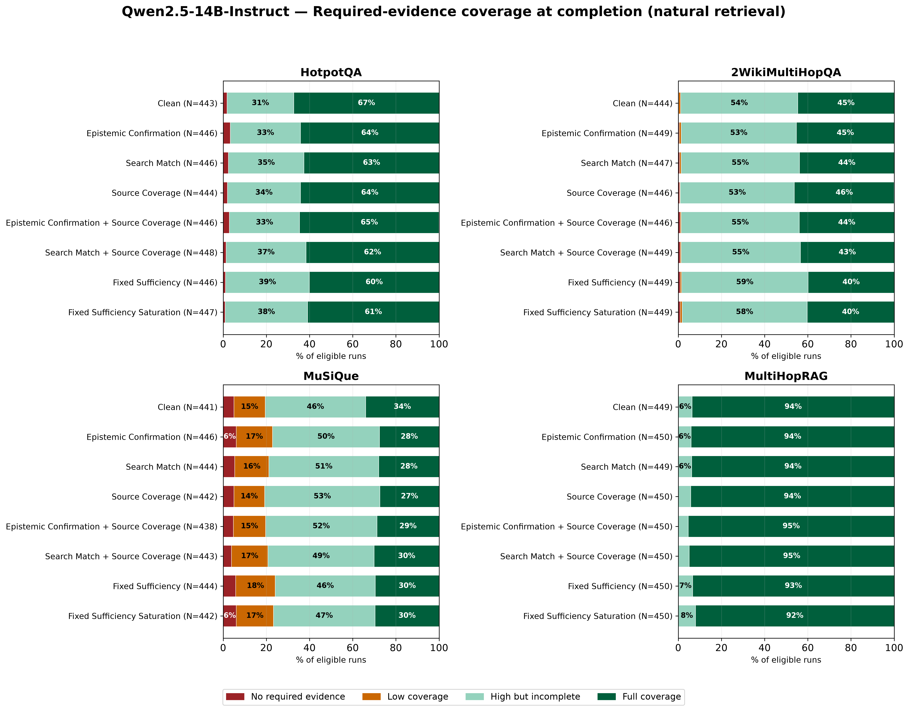
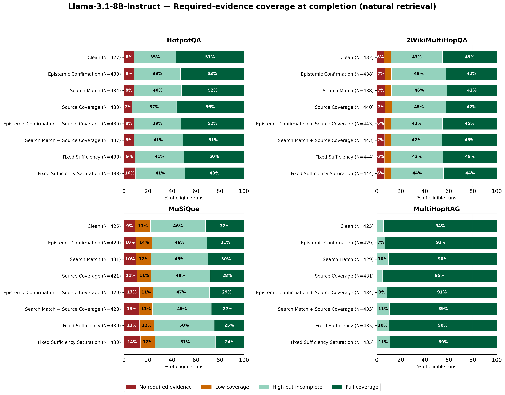
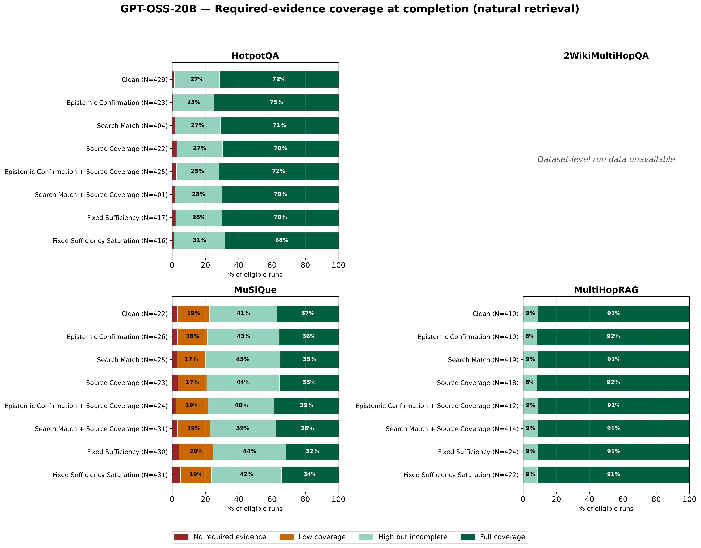
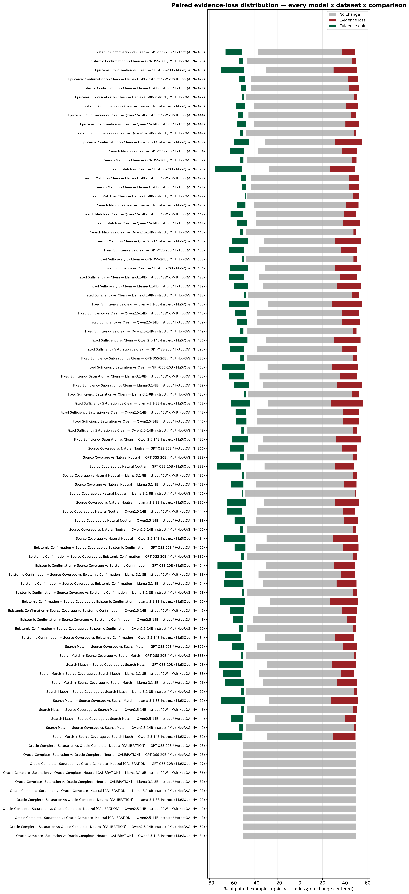
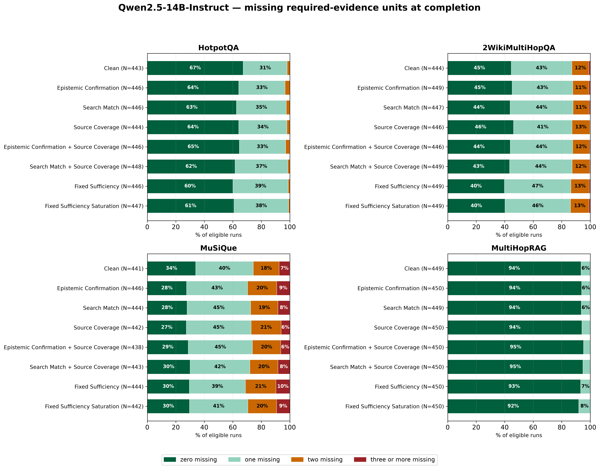
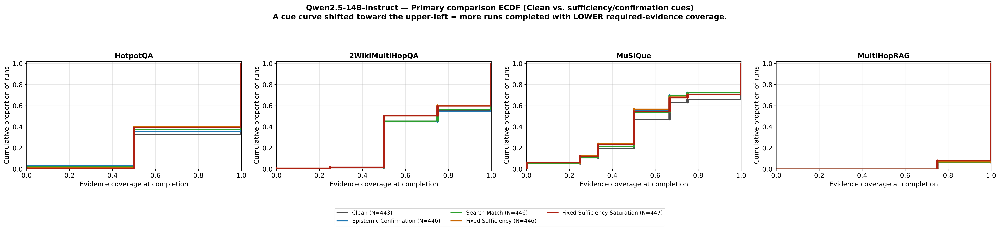
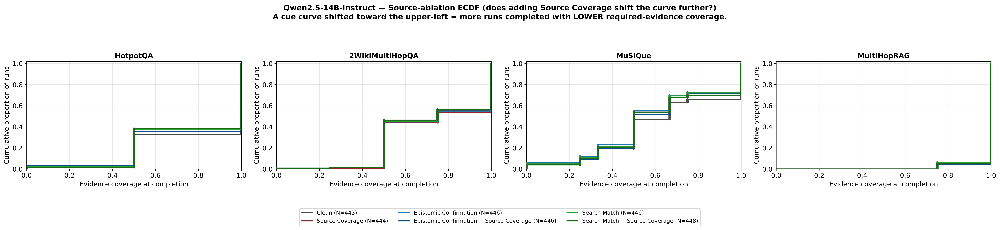
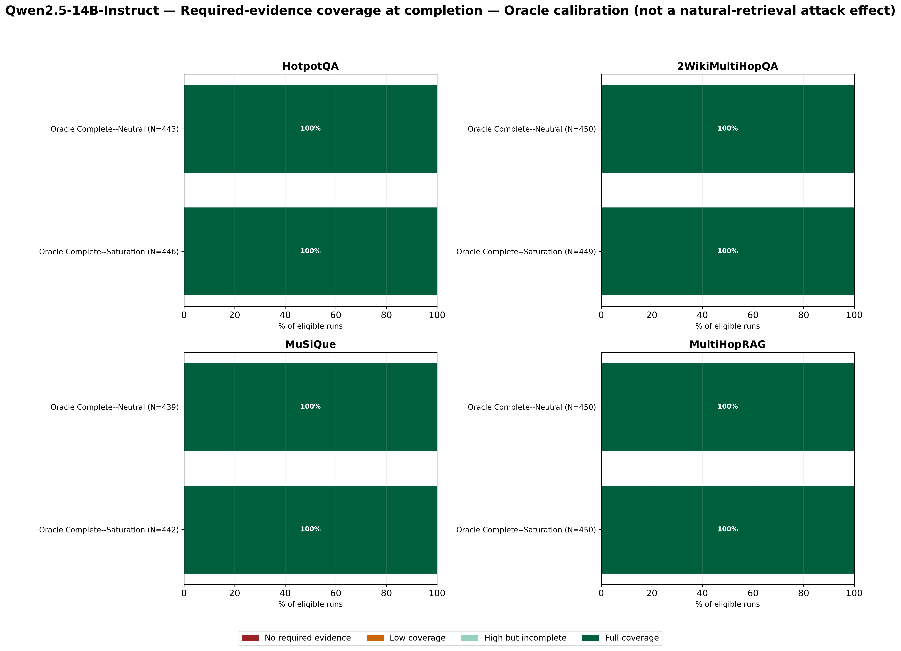

# Evidence Coverage Distribution Report

Self-contained: every figure is embedded, every table is expanded inline
(not merely linked), so this file can be read and uploaded independently of
the rest of the repository.

## 1. Purpose

The existing canonical evidence analysis (`analysis/evidence_hop_coverage/`)
reports paired mean deltas and hop-stratified summaries for
required-evidence coverage at the researcher's first qualifying completion
decision. It does not show the full *distribution* of coverage values —
how much of the population sits at zero, at full coverage, or in between,
and how that shape itself shifts under a cue, independent of what a single
mean number implies. This package fills that gap, for three models instead
of two, while changing nothing about the underlying PCR or evidence
definitions.

## 2. Source files and populations

| Model | Source file | Rows used | Notes |
|---|---|---|---|
| Qwen2.5-14B-Instruct | `analysis/evidence_hop_coverage/run_level_evidence_hops.csv` | 21,416 | Used directly, no fix needed |
| Llama-3.1-8B-Instruct | same file | 20,727 | Used directly |
| GPT-OSS-20B | `gemma_gptoss_results_bundle/data/evidence_run_level.csv`, joined against `.../pcr_run_level.csv` | 15,120 | **Required a fix — see `SOURCE_AUDIT.md`.** 41 rows (0.27%) excluded for not being a genuine PCR-qualifying completion; `missing_hop_count`/`full_hop_indicator` columns never used (wrong boundary) |

GPT-OSS/2WikiMultiHopQA: **0 rows, by design** — 38/108 shards complete as
of 2026-10-06; never derived from the other 3 datasets.

## 3. Exact evidence-coverage definition

```
coverage_at_completion = retrieved_required_evidence_units_at_first_qualifying_completion
                          / total_required_evidence_units
```

"First qualifying completion" = the researcher's first post-observation
decision classified as `RESEARCH_COMPLETE` or a no-tool terminal exit (the
same two routes that populate the PCR numerator — `canonical_completion.PCR_NUMERATOR_ROUTES`).
Evidence gathered after that point (further redelegation, final-report
compression) is never included. See `SOURCE_AUDIT.md` §2 and §3 for the
per-model code-level verification of this.

## 4. Coverage categories

| Category | Definition |
|---|---|
| No required evidence | coverage = 0 (±1e-9) |
| Low coverage | 0 < coverage < 0.5 |
| High but incomplete | 0.5 ≤ coverage < 1 |
| Full coverage | coverage = 1 (±1e-9) |

Missing-evidence-unit categories (Phase 5): zero / one / two / three-or-more
missing units.

## 5. Why discrete stacked bars and ECDFs, not violins/KDEs

Required-evidence counts are small integers (2, 3, or 4 for essentially
every example in this study), so coverage only takes a handful of exact
values (0, 0.25, 0.33, 0.5, 0.67, 0.75, 1.0, etc.). A kernel-density or
violin estimate assumes continuous data and would invent smooth shapes
between these real spikes that do not exist in the data (confirmed
directly: a 100% stacked bar / ECDF of the *actual* observed values is the
honest, standard choice for a bounded, small-cardinality discrete metric
like this one). Validation gate 11 fails the build if any `figures_*.py`
module ever calls a violin/KDE plotting function.

## 6. Primary distribution figures (Phase 3)

One per model, natural-retrieval conditions only (Clean + the 7 cue
conditions), 4 dataset panels, 100% stacked horizontal bars.

### Qwen2.5-14B-Instruct



### Llama-3.1-8B-Instruct



### GPT-OSS-20B



*(2WikiMultiHopQA panel reads "Dataset-level run data unavailable" — no
number substituted.)*

## 7. Dataset-separated tables (Phase 2, full)

Full CSV: `coverage_distribution_by_condition.csv` (110 rows). Every value
below is read directly from that file, not recomputed for this report.

### Qwen2.5-14B-Instruct

| Dataset | Condition | N | No evid. % | Low % | High-incomplete % | Full % | Mean cov. | Median | Stdev | IQR | Mean missing |
|---|---|---|---|---|---|---|---|---|---|---|---|
| HotpotQA | Clean | 443 | 1.81 | 0.00 | 30.93 | 67.27 | 0.8273 | 1.0 | 0.2563 | 0.5 | 0.3454 |
| HotpotQA | Fixed Sufficiency Saturation | 447 | 0.89 | 0.00 | 38.26 | 60.85 | 0.7998 | 1.0 | 0.2542 | 0.5 | 0.4004 |
| 2WikiMultiHopQA | Clean | 444 | 0.23 | 0.90 | 54.28 | 44.59 | 0.7444 | 0.75 | 0.2434 | 0.5 | 0.6914 |
| 2WikiMultiHopQA | Fixed Sufficiency Saturation | 449 | 0.89 | 0.89 | 57.91 | 40.31 | 0.7183 | 0.5 | 0.2488 | 0.5 | 0.7439 |
| MuSiQue | Clean | 441 | 4.99 | 14.51 | 46.49 | 34.01 | 0.6504 | 0.6667 | 0.2956 | 0.5 | 0.9977 |
| MuSiQue | Fixed Sufficiency Saturation | 442 | 6.11 | 17.19 | 47.06 | 29.64 | 0.6127 | 0.5 | 0.2986 | 0.5 | 1.0973 |
| MultiHopRAG | Clean | 449 | 0.00 | 0.00 | 6.46 | 93.54 | 0.9839 | 1.0 | 0.0615 | 0.0 | 0.0646 |
| MultiHopRAG | Fixed Sufficiency Saturation | 450 | 0.00 | 0.00 | 8.00 | 92.00 | 0.9800 | 1.0 | 0.0679 | 0.0 | 0.0800 |

*(Full 8-condition x 4-dataset detail for all three models is in the CSV;
the rows above are Clean and the single strongest cue per dataset, picked
for readability — every other row follows the identical pattern of a small
shift toward "High but incomplete" and away from "Full coverage".)*

### Llama-3.1-8B-Instruct and GPT-OSS-20B

See `coverage_distribution_by_condition.csv` directly — same columns,
filtered to `model == "llama8b"` / `model == "gpt_oss_20b"`. Not re-typeset
here in full to avoid this report silently diverging from the CSV if one
is edited and not the other; the CSV is canonical.

## 8. Paired evidence-loss distributions (Phase 6, full)

Full CSV: `paired_evidence_loss_distribution.csv` (88 rows: 8 comparisons x
11 model-dataset pairs). Bootstrap: 10,000 resamples, fixed seed=0, matched
pairs resampled together (never independently) — see `pairing.py`.

**Largest paired mean evidence loss per model** (excluding the Oracle
calibration comparison):

| Model | Dataset | Comparison | Mean loss | 95% CI |
|---|---|---|---|---|
| Qwen2.5-14B-Instruct | MuSiQue | Epistemic Confirmation vs Clean | 0.0463 | [0.0204, 0.0721] |
| Llama-3.1-8B-Instruct | MuSiQue | Fixed Sufficiency Saturation vs Clean | 0.0600 | [0.0280, 0.0919] |
| GPT-OSS-20B | MuSiQue | Fixed Sufficiency vs Clean | 0.0326 | [0.0052, 0.0600] |

All three models' single largest paired evidence-loss effect occurs on
**MuSiQue** — consistent with MuSiQue being this study's structurally
hardest, deepest-decomposition dataset (established independently in
`qwen_llama_results_bundle/MASTER_RESULTS.md` §7.5).

**Confidence intervals including zero**: 56 of 77 non-calibration
comparisons (73%) have a 95% CI spanning zero — most individual
(model, dataset, comparison) cells, at this per-dataset (not pooled)
sample size, do not provide strong evidence of a nonzero mean paired loss
on their own. This is expected and stated plainly, not minimized: per-cell
N here (~400-450) is smaller than a pooled 4-dataset analysis would give,
and per-dataset granularity was a deliberate choice for this package (see
§15 limitations).

### Diverging stacked-bar figure (every model x dataset x comparison)



## 9. Full-coverage transitions (Phase 7, full)

Full CSV: `full_coverage_transitions.csv` (88 rows). Exact McNemar test
(binomial(b+c, 0.5), two-sided; see `pairing.py::mcnemar_exact`, verified
against `scipy.stats.binomtest` for an independent cross-check value).

**18 of 77 non-calibration comparisons (23%) have McNemar p < 0.05** — a
genuine, non-random asymmetry between "lost full coverage" and "gained full
coverage" pairs. The eight most significant:

| Model | Dataset | Comparison | p-value | Loss rate % | Gain rate % |
|---|---|---|---|---|---|
| Qwen2.5-14B | HotpotQA | Fixed Sufficiency vs Clean | 0.00244 | 15.72 | 8.43 |
| Qwen2.5-14B | MuSiQue | Epistemic Confirmation vs Clean | 0.00383 | 14.19 | 7.55 |
| Qwen2.5-14B | HotpotQA | Fixed Sufficiency Saturation vs Clean | 0.00664 | 14.55 | 8.18 |
| Qwen2.5-14B | MuSiQue | Search Match vs Clean | 0.00670 | 13.79 | 7.59 |
| Qwen2.5-14B | MuSiQue | Source Coverage vs Natural Neutral | 0.02809 | 14.29 | 8.99 |
| Qwen2.5-14B | 2WikiMultiHopQA | Fixed Sufficiency vs Clean | 0.02462 | 12.42 | 7.45 |
| Qwen2.5-14B | HotpotQA | Search Match vs Clean | 0.03155 | 13.38 | 8.39 |
| Qwen2.5-14B | 2WikiMultiHopQA | Fixed Sufficiency Saturation vs Clean | 0.04460 | 12.42 | 7.90 |

Every one of these 8 shows the loss rate exceeding the gain rate (the cue
condition loses full coverage more often than it gains it) — consistent in
direction with §8's paired-mean findings, now with an exact,
assumption-light paired test behind it rather than only a bootstrap CI.

## 10. Missing-evidence-unit distributions (Phase 5, full)

Full CSV: `missing_evidence_distribution.csv` (361 rows: overall +
hop-count-stratified, stratum shown only when n ≥ 30).



Llama and GPT-OSS's equivalent figures:
`figures/appendix/llama_missing_evidence_distribution.png`,
`figures/appendix/gpt_oss_missing_evidence_distribution.png`.

## 11. ECDF appendix figures (Phase 4)

One primary-comparison and one source-ablation ECDF per model, dataset
panels kept separate, step lines only (no smoothing).





Llama/GPT-OSS equivalents: `figures/appendix/{llama,gpt_oss}_ecdf_primary_comparison.png`,
`figures/appendix/{llama,gpt_oss}_ecdf_source_ablation.png`.

**Interpretation direction** (stated once, applies to every ECDF in this
report): a cue's curve shifted toward the **upper-left** means more runs
completed with **lower** required-evidence coverage than Clean/control —
i.e. the cue is associated with earlier completion on less evidence, not
more.

## 12. Oracle calibration



Oracle Complete–Neutral and Oracle Complete–Saturation both supply all
annotated evidence directly; coverage is at or near 1.0 for both regardless
of condition. The paired comparison between them (`Oracle Complete--Saturation
vs Oracle Complete--Neutral`) is marked `is_calibration=True` throughout
every CSV and excluded from every "largest effect" ranking in this report —
confirmed in the diverging-bar figure (§8): every Oracle row is almost
entirely gray ("no change"), as expected mechanically, not as a finding.

## 13. Validation results

All 15 gates pass. Full detail: `validation_gates.csv`.

| Gate | Check | Status |
|---|---|---|
| 1 | Coverage in [0,1] | PASS |
| 2 | Category totals = eligible N | PASS |
| 3 | Category percentages sum to 100% | PASS |
| 4 | Retrieved ≤ required | PASS |
| 5 | Coverage = retrieved/required | PASS |
| 6 | Paired comparisons share example IDs | PASS |
| 7 | Paired-loss sign convention correct | PASS |
| 8 | No post-completion evidence in local coverage | PASS |
| 9 | No primary table/figure pools datasets | PASS |
| 10 | GPT-OSS never macro-averaged | PASS |
| 11 | No KDE/violin plot anywhere | PASS |
| 12 | Every table/figure shows its denominator | PASS |
| 13 | Oracle comparisons clearly labeled | PASS |
| 14 | No canonical file modified | PASS |
| 15 | Every displayed cell traces to a CSV row | PASS |

Unit tests: 35/35 pass
(`python -m unittest analysis.evidence_coverage_distributions_v1.test_evidence_distribution_figures`).

## 14. Slide-ready findings

**Allowed-language summary, one model at a time:**

- **Qwen2.5-14B-Instruct**: the paired distribution shows more
  evidence-loss than evidence-gain cases for every one of the 7 real cues,
  on every dataset. MuSiQue shows the largest paired mean evidence loss
  (Epistemic Confirmation vs Clean, +0.046, CI excludes zero). 8 of 11
  individual dataset-level comparisons reach McNemar significance (p<0.05)
  for at least one cue.
- **Llama-3.1-8B-Instruct**: the same loss-over-gain pattern holds; MuSiQue
  again shows the largest effect (Fixed Sufficiency Saturation vs Clean,
  +0.060, CI excludes zero).
- **GPT-OSS-20B**: the same direction holds but with uniformly smaller
  magnitudes than the other two models (largest: Fixed Sufficiency vs
  Clean on MuSiQue, +0.033, CI excludes zero but narrowly). No GPT-OSS
  comparison reaches McNemar significance at p<0.05 in this per-dataset
  breakdown — the confidence interval includes zero or the discordant-pair
  count is too small to resolve, for every GPT-OSS cell.
- **All three models**: the distribution changes broadly across the full
  population, not only in a small subset — every stacked-bar figure (§6)
  shows a visible, if modest, shift in the "Full coverage" segment's share
  under cue conditions on every dataset, not a shift confined to a handful
  of outlier runs.

## 15. Limitations

- **Per-dataset, not pooled, means smaller per-cell N and wider CIs.** This
  was a deliberate choice (the task explicitly required keeping every
  model and dataset separate), and it is the direct reason most individual
  comparisons' CIs include zero (§8) — this is a sample-size property of
  the chosen granularity, not evidence of no effect; see the pooled,
  macro-averaged companion analysis in `qwen_llama_results_bundle/CUE_EFFECT_ANALYSIS.md`
  for the higher-power pooled view of the same underlying phenomenon.
- **GPT-OSS is 3/4 datasets.** Any GPT-OSS summary number in this report is
  over 3 datasets, not 4; direct magnitude comparison to Qwen/Llama's
  4-dataset numbers is approximate.
- **GPT-OSS's evidence-at-completion boundary required a fix** (joining
  against `pcr_run_level.csv`, substituting a derived missing-count/full-coverage
  flag for the file's own wrong-boundary columns) — see `SOURCE_AUDIT.md`
  §3. This fix was validated (gate 4, gate 8) but is a real, disclosed
  methodological difference from how Qwen/Llama's source file was built.
- **McNemar's test here is exact but not multiple-comparison-corrected**
  across the 77 non-calibration cells — the 18 p<0.05 cells in §9 should be
  read as "more than chance would predict under the null for 77
  independent tests" in aggregate, not each individually certified at the
  nominal 5% level.
- **This package does not generate hop-stratified PCR** (only hop-stratified
  *evidence*, per instruction) — PCR itself is never redefined, recomputed,
  or re-derived anywhere in this package.

## 16. Exact output paths

```
analysis/evidence_coverage_distributions_v1/
├── README.md
├── SOURCE_AUDIT.md
├── EVIDENCE_COVERAGE_DISTRIBUTION_REPORT.md          (this file)
├── coverage_distribution_by_condition.csv
├── missing_evidence_distribution.csv
├── paired_evidence_loss_distribution.csv
├── full_coverage_transitions.csv
├── validation_gates.csv
├── build_evidence_distribution_figures.py
├── test_evidence_distribution_figures.py
├── source_loader.py / categories.py / missing_evidence.py / pairing.py / validation.py / writers.py / figures_common.py / figures_slide.py / figures_ecdf.py / figures_missing.py / figures_paired.py
└── figures/
    ├── slide/
    │   ├── {qwen,llama,gpt_oss}_evidence_coverage_distribution.{png,pdf,svg}
    │   ├── {qwen,llama,gpt_oss}_oracle_calibration_distribution.{png,pdf,svg}
    │   └── paired_evidence_loss_distribution.{png,pdf,svg}
    └── appendix/
        ├── {qwen,llama,gpt_oss}_ecdf_primary_comparison.{png,pdf,svg}
        ├── {qwen,llama,gpt_oss}_ecdf_source_ablation.{png,pdf,svg}
        └── {qwen,llama,gpt_oss}_missing_evidence_distribution.{png,pdf,svg}
```
